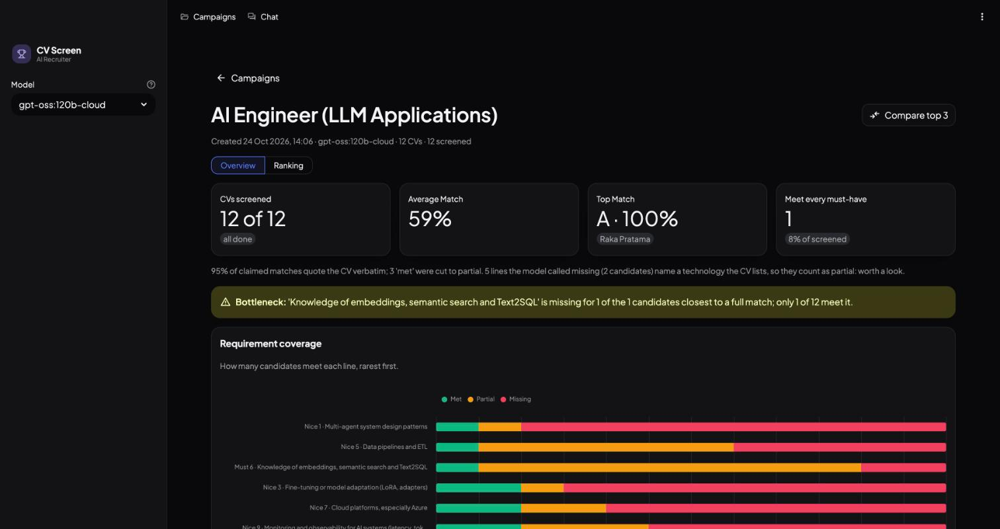
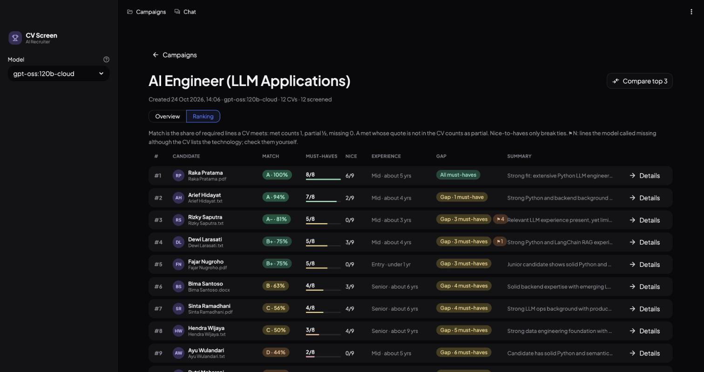
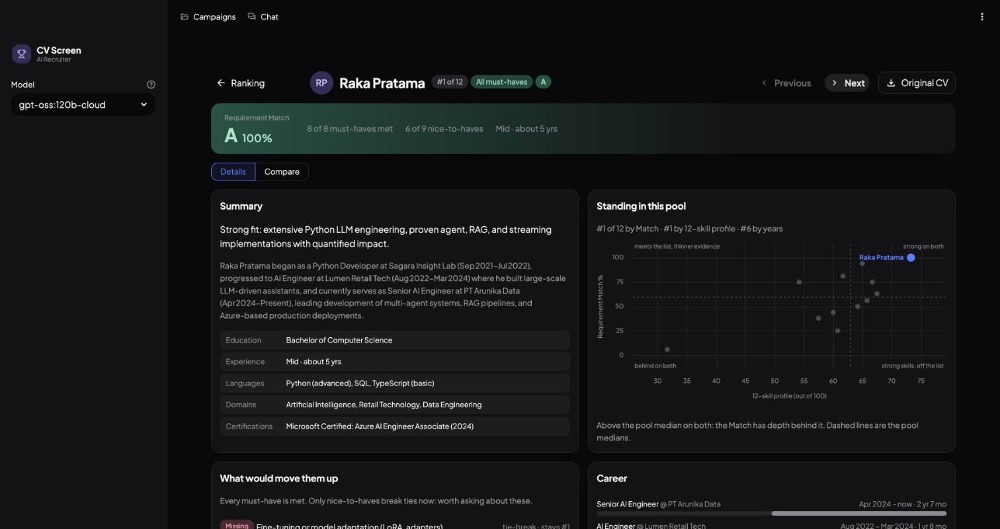

# CV Screen Lite

A Streamlit app that screens and ranks CVs against a job opening with an LLM. Every finding is backed by a quote
from the CV, and code checks each quote against the CV text.



## What it does

- **Campaigns.** Enter the job title, responsibilities, required lines and nice-to-have lines, then upload CVs
  (PDF, DOCX, TXT or a ZIP of them).
- **Background screening.** Leaving the page does not stop a run. Failed CVs can be retried without re-running the
  rest, and an interrupted run resumes from the CVs that have no result yet.
- **Ranking.** Candidates are ranked by Requirement Match, alongside the must-haves and nice-to-haves each one
  meets, years of experience and a short summary.
- **Candidate page.**
  - Requirement coverage with a CV quote for each line.
  - A 12-skill radar against the pool median.
  - A career timeline.
  - Strengths, weaknesses and red flags.
  - What would move the candidate up the ranking.
  - The CV itself with the evidence highlighted.
- **Compare.** Up to four candidates side by side: an overlaid skill radar, a score matrix, requirement coverage
  and head-to-head skill bars.
- **Overview.** Insights across the whole candidate pool:
  - Requirement coverage, and the requirement that blocks the most candidates.
  - The candidates closest to a full match.
  - Strong profiles with a below-median match.
  - Experience vs match, and the grade distribution.
  - Skill medians, the technologies the pool lists, and red flags to check.
- **Chat.** Ask questions about one campaign's candidates. The answers stream in as they are written. The chat
  sees the job, every candidate's screening results, and the full CV text of the top candidates (or of the one
  candidate you picked).

| Ranking | Candidate |
|---|---|
|  |  |

## How screening works

1. **Two LLM calls per CV.**
   - *Scoring* rates 12 skill dimensions out of 10. Each comes with evidence and a CV quote. It also gives every
     job requirement a verdict (met, partial or missing) with a quote.
   - *Extraction* pulls out education, years of experience, work history, technologies, projects, strengths,
     weaknesses and red flags.
2. **Quote check.** Code looks up every quote in the CV text.
   - A "met" whose quote is not in the CV counts as partial.
   - Skill quotes, work-history rows, technologies and red flags that cannot be found are dropped or marked
     unverified.
3. **Listed-skill guard.** A "missing" verdict on a line that names a technology the CV lists counts as partial.
   The line is flagged ⚑ for the recruiter to check.
4. **Requirement Match.** This is the share of required lines met: met = 1, partial = 0.5, missing = 0.
   - Grades: A (90+), A- (80+), B+ (70+), B (60+), C (45+), D (below 45).
   - Nice-to-haves only break ties.
5. **Failures stay visible.** Unusable model output is an error, never read as "nothing found". The CV shows as
   failed and can be retried.

## Models

| Provider | Model | How it runs |
|---|---|---|
| [Ollama](https://ollama.com) (default) | Any model your local Ollama serves, e.g. the cloud model `gpt-oss:120b-cloud` | Through Ollama's OpenAI-compatible API, one CV at a time |
| Anthropic (optional) | Claude Haiku 5.5 | Through the Anthropic API when `ANTHROPIC_API_KEY` is set. Four CVs at a time (`CV_WORKERS`), with prompt caching on the system prompt |

## Quick start

Requires Python 3.10 or newer.

```bash
git clone https://github.com/Rembr4nt/cv-screen-lite.git
cd cv-screen-lite
python -m venv .venv && source .venv/bin/activate
pip install -r requirements.txt
cp .env.example .env            # add ANTHROPIC_API_KEY here to enable Claude

ollama signin                   # cloud models need an ollama.com account
ollama pull gpt-oss:120b-cloud

streamlit run app.py
```

To try it out, create a campaign from `sample_data/sample_job.txt` and upload `sample_data/sample_cvs.zip`. The
zip holds 12 **fictional** CVs for an AI Engineer opening. They have mixed formats and a deliberate spread of
profiles, from a strong match to a CV full of red flags.

## Self-checks

Each core module has an `assert`-based self-check. None of them needs a model or the network.

```bash
python scoring.py && python workspace.py && python insights.py && python charts.py
```

## Project layout

```
app.py          navigation, sidebar, campaigns grid, new-campaign form, chat
views.py        campaign (overview + ranking), candidate and compare pages
scoring.py      CV reading, prompts, strict parsing of model output, quote checks
insights.py     Requirement Match, grades, career notes, pool insights
charts.py       Altair / Plotly charts and HTML pieces
style.py        light and dark palette, pills, card CSS
workspace.py    campaign folders on disk and the background screening thread
sample_data/    a fictional job opening and 12 fictional CVs
```

Campaigns are saved locally under `workspace/`: the original CVs plus one JSON result per CV. This folder is
ignored by git.

## Limitations

- Screening accuracy has not been measured against human-labelled decisions. Treat the scores as a reading aid;
  the recruiter makes the decision.
- Verdicts check whether a CV shows a capability, not how credible the claim is.
  - In the sample data, a CV of broad claims with no specifics ("Worked with all vector databases") still ranks
    third.
  - Its overlapping job dates are not flagged.
  - Tightening the prompt's "met" rule did not fix this with `gpt-oss:120b-cloud`: it downgraded concrete CVs
    instead.
- Results vary between runs. Screening the same 12 sample CVs twice with `gpt-oss:120b-cloud` moved one CV from
  88% to 81%; the others moved 6 points at most.
- Different models can grade the same CV differently.
- There is no OCR, so scanned (image-only) PDFs are skipped.
- CV text is sent to the model provider you choose. Only upload CVs you are allowed to process.
- It is a single-user local app with no login.

## License

[MIT](LICENSE)
